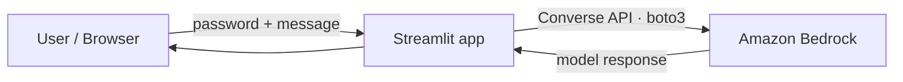

# 🤖 AWS Bedrock AI Assistant

A password-protected chatbot built with **Python**, **Streamlit** and **Amazon Bedrock** (Converse API).
Simple on purpose: a small, readable codebase that shows how to talk to a foundation model on AWS
without exposing it (and your token budget) to the whole internet.

<!-- Add a screenshot at docs/screenshot.png and uncomment the line below -->
<!--  -->

## ✨ Features

- 🔒 **Password login** – the password is read from an environment variable, so strangers can't burn your tokens
- 💬 **Conversation memory** – the last messages are sent to the model on every turn
- 🔁 **Model-agnostic** – uses the Bedrock **Converse API**; switch models by changing one env var
- 💸 **Cost control** – capped response length and capped history size
- 🛡️ **Safe error handling** – AWS errors are shown in the UI instead of crashing the app

## 🏗️ Architecture



## 🧰 Tech stack

| Layer | Tool |
|-------|------|
| UI | Streamlit |
| AWS SDK | boto3 |
| Model access | Amazon Bedrock (Converse API) |
| Config | python-dotenv |

## 🚀 Getting started

### Prerequisites
- Python 3.10+
- An AWS account with **Amazon Bedrock** available in your region and access to the chosen model
- AWS credentials allowed to call Bedrock (`bedrock:InvokeModel`)

### Run locally

```bash
git clone https://github.com/Guilherme-Peres-Dev/aws-bedrock-chatbot.git
cd aws-bedrock-chatbot

python -m venv .venv
source .venv/bin/activate        # Windows: .venv\Scripts\activate
pip install -r requirements.txt

cp .env.example .env             # Windows: copy .env.example .env
# edit .env with your values

streamlit run main.py
```

Open http://localhost:8501 and log in with the password you set in `APP_PASSWORD`.

## ⚙️ Configuration

| Variable | Required | Description |
|----------|----------|-------------|
| `APP_PASSWORD` | ✅ | Password required to use the chat. The app refuses to open without it. |
| `AWS_ACCESS_KEY_ID` | ✅* | AWS access key |
| `AWS_SECRET_ACCESS_KEY` | ✅* | AWS secret key |
| `AWS_DEFAULT_REGION` | ❌ | Bedrock region (default `us-east-1`) |
| `BEDROCK_MODEL_ID` | ❌ | Model ID (default `mistral.devstral-2-123b`) |

\* Not needed when running on AWS with an IAM role.

Response length (`MAX_TOKENS`) and history size (`MAX_HISTORY`) are constants at the top of `main.py`.

## 🔐 Security notes

- `.env` is git-ignored. **Never commit credentials.**
- Use an IAM user/role with the **minimum** permissions (only invoking Bedrock).
- Run behind **HTTPS** if you deploy it publicly, otherwise the password travels in clear text.
- Set an AWS Budget alert to be notified of unexpected costs.

## 🗺️ Roadmap

- [ ] Streaming responses
- [ ] Token usage and estimated cost in the sidebar
- [ ] Custom system prompt / specialised assistant
- [ ] Docker image + deploy on AWS (EC2 / App Runner) using an IAM role
- [ ] Infrastructure as code (Terraform)

## 📄 License

MIT – feel free to use and adapt.

---

<details>
<summary>🇧🇷 Resumo em português</summary>

Chatbot com **Streamlit** e **Amazon Bedrock**, protegido por senha (lida de variável de ambiente) para evitar consumo indevido de tokens.

**Como rodar:**

```bash
pip install -r requirements.txt
copy .env.example .env     # preencha com suas chaves e senha
streamlit run main.py
```

O modelo pode ser trocado pela variável `BEDROCK_MODEL_ID`, pois o app usa a Converse API do Bedrock.
Nunca suba o arquivo `.env` para o GitHub.

</details>
